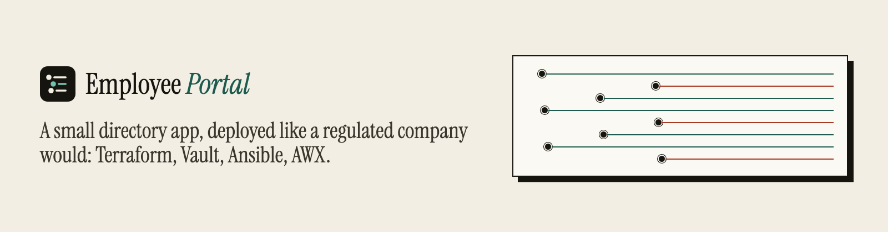
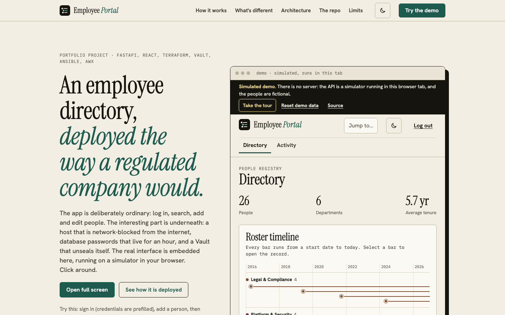
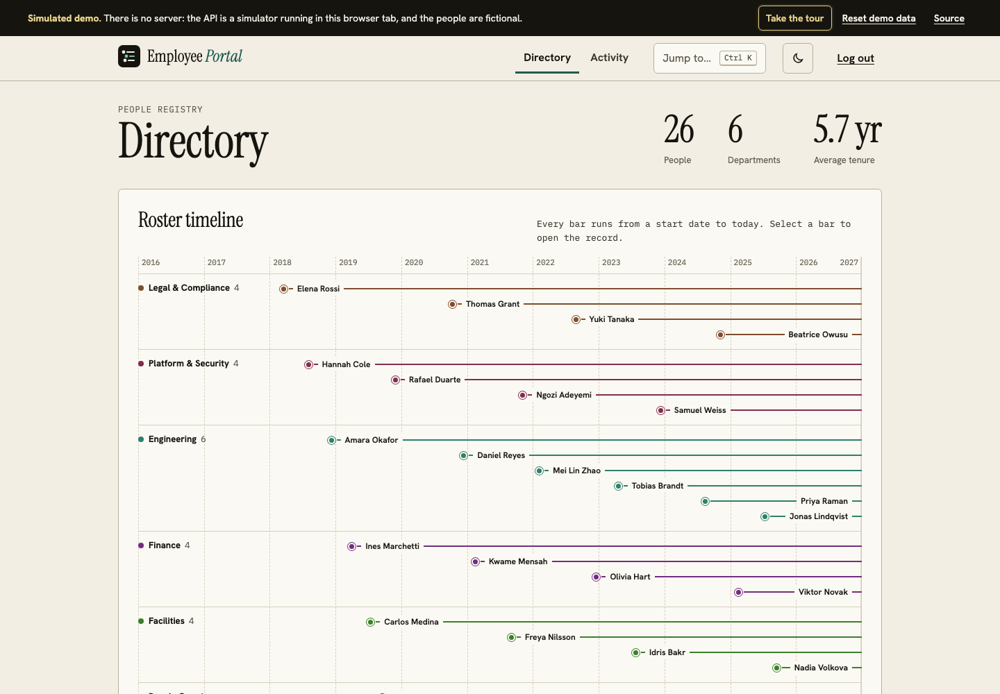
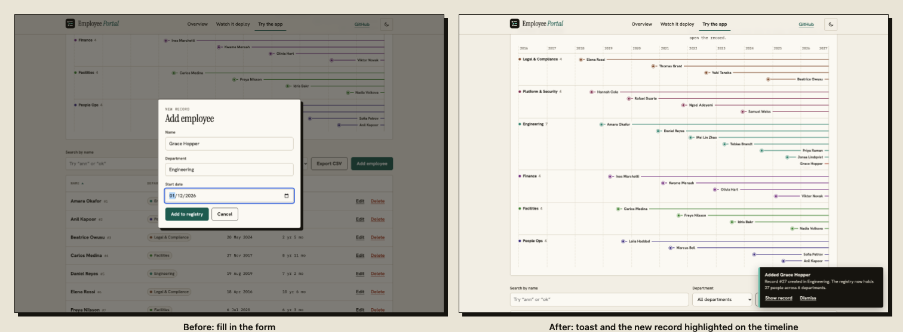
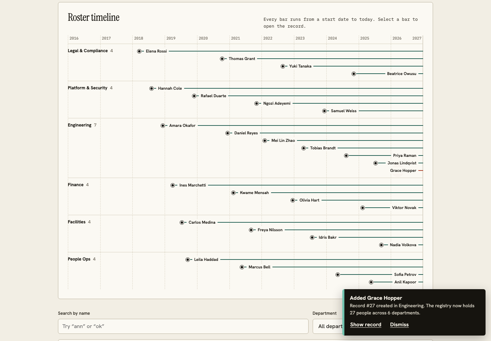
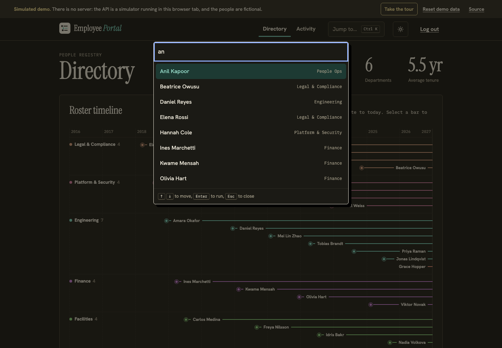
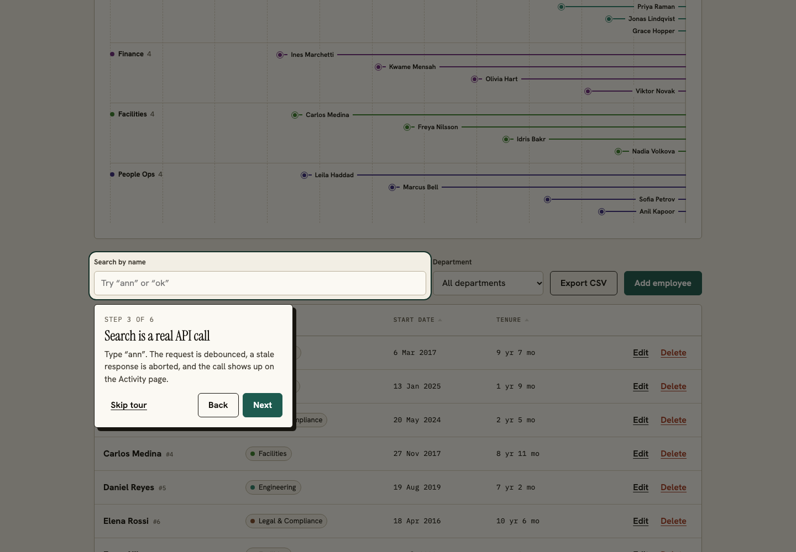
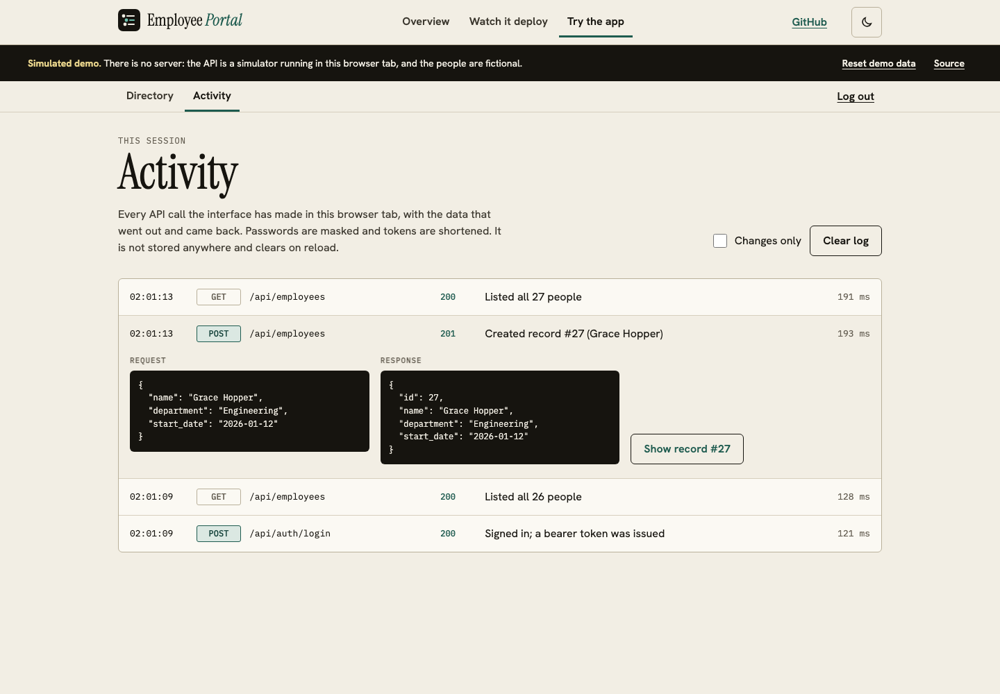
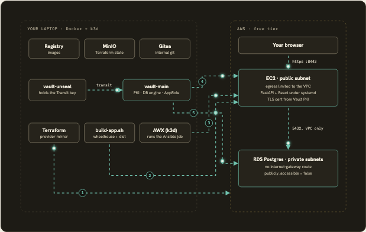
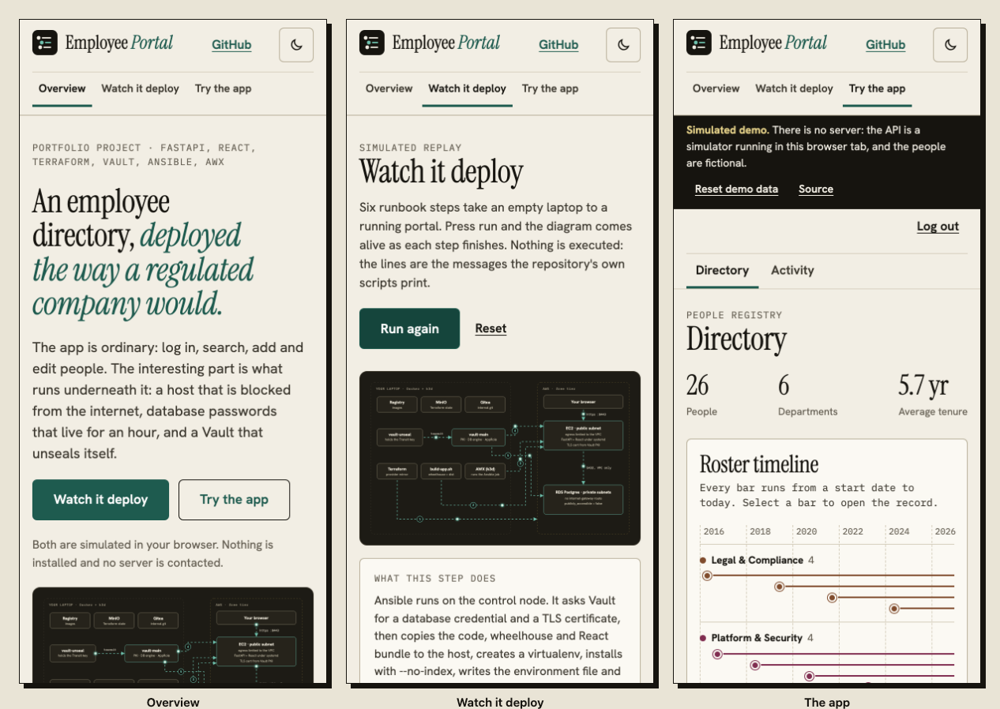

<p align="center"></p>


**Live demo (no install, simulated backend): https://sakar1601.github.io/internal-employee-portal/**
(this link works once GitHub Pages is enabled for the repo, see [Deployment notes](#deployment-notes)).
Or run `docker compose up --build` and open http://localhost:8080.

[](https://sakar1601.github.io/internal-employee-portal/)

## What it is

An internal employee directory (the small line-of-business app every mid-size company has) deployed the way a regulated,
network-isolated enterprise would: no public Terraform registry, no cloud KMS, no public Ansible Galaxy, a prebuilt pip
wheelhouse, and an app host that is network-blocked from the internet.

It is one project telling two stories:

- **The application**: a FastAPI backend with JWT auth and CRUD over an employee table, and a React frontend with a
  department-coloured roster timeline, search, filter, sortable columns, add/edit/delete, CSV export, a Ctrl/Cmd+K
  command palette, dark mode and a session Activity log. The demo adds a guided tour.
- **The platform underneath it**: Terraform (VPC, EC2, RDS), two HashiCorp Vault clusters that unseal each other, Ansible,
  and AWX. This is the point of the project; see [`infra/docs/architecture.md`](infra/docs/architecture.md).

## Screenshots

All screenshots were captured by Playwright from the built static demo (`npm run build:demo`, then
`node scripts/capture-screenshots.mjs`), so they show the **simulated backend with fictional people**.

### The working app



*Directory: the roster timeline draws each person as a bar from their start date to today, grouped by department.*

### Every action says what happened



*Adding a person: the toast states the effect on the data (27 people across 6 departments) and links to the record.*



### Keyboard first, and dark mode



*Ctrl/Cmd+K jumps to any person or runs any action. The theme follows the OS and can be toggled; the choice is remembered.*

### A guided tour (demo only)



### Activity: the API calls behind the UI



*Activity: each call the interface made, with request and response (passwords masked, tokens shortened).*

### Architecture



*On the landing page this diagram is animated and each deployment step highlights its part.*

### On a phone (390 px)



## How it works

1. **Lab services** (`01-bring-up-services.sh`): registry, MinIO (Terraform state), Gitea, `vault-unseal`.
2. **Vault** (`02-bootstrap-vault.sh`): `vault-main` auto-unseals through `vault-unseal`'s Transit key; PKI and an AppRole are set up.
3. **AWS** (`03-terraform-apply.sh`): VPC, EC2 with VPC-only egress, RDS in private subnets; Vault's database engine is pointed at RDS through an SSH tunnel (1 h default TTL).
4. **AWX** (`04-awx-up.sh`): k3d cluster running AWX.
5. **Build** (`build-app.sh`): pip wheelhouse for the target platform plus the React bundle.
6. **Deploy**: Ansible fetches a database credential and certificate from Vault on the control node, copies everything over and installs with `pip install --no-index`.

## What's different

- **Credentials that expire**: dynamic Postgres roles with `VALID UNTIL`, created `IN ROLE app_role_group` ([`03-terraform-apply.sh`](infra/scripts/03-terraform-apply.sh)).
- **A host that cannot reach the internet**: security-group egress limited to the VPC CIDR; RDS has `publicly_accessible = false` ([`main.tf`](infra/terraform/main.tf)).
- **Self-unsealing Vault** without a cloud KMS ([`02-bootstrap-vault.sh`](infra/scripts/02-bootstrap-vault.sh)).
- **Offline dependency install** from a wheelhouse built ahead of time ([`build-app.sh`](infra/scripts/build-app.sh)).
- **A demo that runs the real flows**: the UI talks to one module, [`app/frontend/src/api/index.js`](app/frontend/src/api/index.js); a build flag swaps HTTP for a tested simulator.

## Architecture

### Application

- **Backend** — FastAPI (`app/backend/app`), SQLAlchemy models against
  Postgres, and a small set of routers:
  - `POST /api/auth/login` — OAuth2 password flow, checks the submitted
    credentials against a single configured admin user (username plus a
    bcrypt password hash, both supplied via environment/settings — no
    self-registration), returns a signed JWT (`PyJWT`, HS256).
  - `GET/POST /api/employees`, `GET/PUT/DELETE /api/employees/{id}` — full
    CRUD over an `Employee` model (`name`, `department`, `start_date`),
    with optional `search` (name, case-insensitive), `department`, `limit` and `offset`
    on the list endpoint. Every route in this router depends on
    `get_current_user`, which decodes and validates the bearer JWT — there
    is no unauthenticated path to employee data.
  - `GET /healthz` — unauthenticated liveness check.
  - In production, `app/main.py` (`mount_frontend`) also serves the built React app
    (`app/frontend/dist`): real files from the folder, `index.html` for client-side routes,
    and a 404 for unknown `/api` paths. The same FastAPI process serves the API and the UI.
- **Frontend** — React 19 + Vite (`app/frontend/src`): a login page, a directory page (summary numbers, roster
  timeline, debounced search with stale-response abort, department filter, add/edit/delete dialogs with toast feedback)
  and an Activity page. All backend access goes through `src/api/index.js`, which attaches the JWT, logs each call for the
  Activity page and signals an expired session on a 401.
- **Data** — Postgres in production (RDS), SQLite for local dev — the app
  is unaware of which; `DATABASE_URL` is the only thing that changes.

### Platform

The full Terraform + Vault + Ansible + AWX story — the provider mirror,
Vault's dual-cluster Transit auto-unseal, dynamic short-lived database
credentials, internal PKI, the network topology that makes "no internet
access" a security-group fact rather than a promise, and the two design
decisions worth understanding precisely (where Vault-integration tasks
actually execute, and how egress is locked down without literally cutting
the route) — is documented in full, with a diagram, in
[`infra/docs/architecture.md`](infra/docs/architecture.md).

## Three ways to run it

### 1. Static demo (nothing to install)

Open the live demo link above. Or build it yourself:

```bash
cd app/frontend
npm ci
npm run build:demo        # landing page + simulated app in dist-demo/
npx vite preview --outDir dist-demo
```

The demo is the real UI over an in-browser simulator ([`simulator.js`](app/frontend/src/api/simulator.js)) that mirrors the
backend's routes, auth, validation and ordering. Sign in with the prefilled `admin` / `demo-password`. Those credentials
exist only in the simulator and unlock nothing else. The app says it is simulated in a banner on every page.

### 2. One command with Docker (real backend, SQLite)

```bash
docker compose up --build        # then open http://localhost:8080
```

Sign in with `admin` / `demo-password`. These are local-only defaults in [`compose.yaml`](compose.yaml); override
`JWT_SECRET` and `ADMIN_PASSWORD_HASH` for anything else. This runs the real FastAPI service, serving the built React app,
on a SQLite file in a Docker volume. The database starts empty.

### 3. Real services

Backend and frontend on your machine (SQLite, no AWS):

```bash
cd app/backend
python3 -m venv .venv && source .venv/bin/activate
pip install -r requirements-dev.txt
export DATABASE_URL=sqlite:///./dev.db JWT_SECRET=dev-secret ADMIN_USERNAME=admin
export ADMIN_PASSWORD_HASH="$(python -c "import bcrypt; print(bcrypt.hashpw(b'dev-password', bcrypt.gensalt()).decode())")"
uvicorn app.main:app --reload
```

```bash
cd app/frontend && npm ci && npm run dev     # http://localhost:5173, proxies /api to :8000
```

### Deploy the full platform

```bash
git clone https://github.com/Sakar1601/internal-employee-portal.git && cd internal-employee-portal

infra/scripts/01-bring-up-services.sh    # registry, minio, gitea, vault-unseal
infra/scripts/02-bootstrap-vault.sh      # both Vault clusters, transit auto-unseal, PKI, AppRole
infra/scripts/03-terraform-apply.sh      # provider mirror, VPC/EC2/RDS, then wires Vault to real RDS
infra/scripts/04-awx-up.sh               # k3d + AWX, cross-network wiring

# build the deployable artifacts: a pip wheelhouse for the backend
# (downloaded ahead of time, targeting the instance's Python/platform, so
# nothing is fetched from the internet on the target) and the compiled
# React static bundle
infra/scripts/build-app.sh

# deploy the app for real:
source secrets/ansible-approle.env
ansible-playbook -i "$(terraform -chdir=infra/terraform output -raw portal_public_ip)," \
  infra/ansible/site.yml \
  --private-key secrets/portal-lab-ssh-key -u ec2-user \
  -e vault_role_id=$ANSIBLE_ROLE_ID -e vault_secret_id=$ANSIBLE_SECRET_ID \
  -e db_host=$(terraform -chdir=infra/terraform output -raw rds_endpoint)

# then open https://<portal_public_ip>:8443/ — self-signed internal CA,
# your browser will warn about it, that's expected and correct

infra/scripts/99-teardown.sh             # tears everything down, verifies nothing billable remains
```

Each script prints a checkpoint and what to run next.
[`infra/docs/architecture.md`](infra/docs/architecture.md) covers what each piece is
standing in for, plus two design decisions worth understanding precisely
(where Vault-integration tasks actually execute, and how egress is locked
down without literally cutting the route).

## Configuration

| Variable | Where | Default | Meaning |
|---|---|---|---|
| `DATABASE_URL` | backend | required | SQLAlchemy URL (`sqlite:///...` or `postgresql://...`) |
| `JWT_SECRET` | backend | required | HS256 signing key |
| `ADMIN_USERNAME` | backend | required | The single admin login |
| `ADMIN_PASSWORD_HASH` | backend | required | bcrypt hash of the admin password |
| `JWT_EXPIRE_MINUTES` | backend | `60` | Token lifetime |
| `FRONTEND_DIST_PATH` | backend | `app/frontend/dist` | Built SPA to serve; skipped if the folder is missing |
| `VITE_DEMO` | frontend build | unset | `true` swaps the API for the in-browser simulator (`npm run build:demo` sets it) |
| `SITE_URL` | landing build | `./` | Absolute site URL used in Open Graph tags |

Example files for the infra side: [`infra/ansible/inventory/hosts.ini.example`](infra/ansible/inventory/hosts.ini.example),
[`infra/terraform/.terraformrc.example`](infra/terraform/.terraformrc.example).

## API

`POST /api/auth/login` (OAuth2 password form) returns a bearer token. Everything below needs it.
`GET /api/employees?search=&department=&limit=&offset=` (search is a case-insensitive substring of the name, `%` and `_`
are literal; `limit` 1 to 1000, default 500), `POST /api/employees`, `GET|PUT|DELETE /api/employees/{id}`,
`GET /healthz` (no auth). Names are trimmed and limited to 200 characters, departments to 100; violations are 422.

## Repo layout

```
app/
  backend/            FastAPI: routers, models, schemas, auth, config, tests
  frontend/           React + Vite app, plus landing/ (portfolio page) and scripts/
    src/api/          the seam: index.js (transport switch), http.js, simulator.js, activity.js
    src/features/     auth, directory, activity, demo (banner + guided tour)
    src/shared/       ui (modal, toasts, palette, theme toggle), layout, lib
    landing/          the portfolio page (plain HTML/CSS/JS)
    e2e/              Playwright tests against the static demo build
infra/                Terraform, Ansible, Vault, AWX, lab compose file, runbook scripts, docs
docs/                 brand.md and images/ (README screenshots)
Dockerfile, compose.yaml   one-command local run
.github/workflows/    validate.yml (CI) and pages.yml (static demo site)
```

Package READMEs: [`app/backend`](app/backend/README.md), [`app/frontend`](app/frontend/README.md),
[`infra`](infra/README.md). Brand: [`docs/brand.md`](docs/brand.md).

## Tests and CI

- Backend: `cd app/backend && JWT_SECRET=x python -m pytest` (23 tests: auth, CRUD, validation, search escaping, pagination, SPA mounting).
- Frontend unit tests: `cd app/frontend && npm test` (35 vitest tests: the simulator's contract, the seam in both modes, sorting, CSV, palette filtering, formatting) and `npm run lint`.
- Browser tests: `npm run build:demo && npm run test:e2e` (or `BASE_URL=https://.../ npm run test:e2e` against a deployed site; 38 Playwright tests against the static demo: every button and link on the landing page and the app, keyboard flows, dark mode, the tour, CSV download, no console errors, no horizontal overflow from 320 to 1280 px).
- CI ([`validate.yml`](.github/workflows/validate.yml)): `terraform fmt` + `validate`, `ansible-lint`, backend tests, frontend build + lint + unit tests + static demo build + the Playwright suite.

## Deployment notes

- **GitHub Pages**: [`pages.yml`](.github/workflows/pages.yml) builds the static demo on every push to `main`. It deploys only when
  the repository variable `ENABLE_PAGES` is `true`, after you set *Settings, Pages, Source: GitHub Actions*. The build uses
  relative paths and hash routing, so it works under `/<repo>/` with no base-path setting.
- **AWS platform**: see below; it costs money if you leave it running (`99-teardown.sh` removes it).

## What's real vs. what's simplified

| | |
|---|---|
| **Real** | A working FastAPI + React app with JWT auth and full CRUD, AWS infrastructure including RDS, Vault's transit auto-unseal, dynamic DB credentials issued against a live database, PKI cert issuance, AWX running real Job Templates |
| **Simplified for a solo lab** | TLS disabled on Vault's *own* listener (lab speed only, flagged inline — never do this for real; the app's TLS, from Vault PKI, is real), a self-signed PKI root instead of an offline org root CA, `registry:2` instead of Harbor, Gitea instead of GitLab, a single hardcoded admin user instead of a full user/role system |
| **Not literally true** | This is not a physically air-gapped network — it's a real AWS account reachable from the internet, with the *specific instance's* internet access removed at the security-group/egress level. The app's own dependencies follow the same discipline via a pre-built pip wheelhouse (`infra/scripts/build-app.sh` downloads the exact wheels needed for the target platform ahead of time; Ansible copies them in and installs with `pip install --no-index --find-links=...`) — no live PyPI call from the target, and no hand-vendored source tree either |

## Cost

RDS `db.t3.micro` (750 hrs/month, 20GB) and EC2 `t2.micro` are both
free-tier eligible for 12 months. `infra/scripts/99-teardown.sh` destroys
everything and verifies via the AWS CLI that neither is still running —
check the AWS Billing dashboard once after your first apply regardless.


## Status and known gaps

- The application and the simulator are covered by the tests above. The AWS/Vault/AWX deployment is documented and scripted; the
  statements in this README about having run it end to end are the author's, and CI only checks Terraform/Ansible syntax and lint.
- One admin user, no roles, no persisted audit trail (the Activity page is this tab's memory only). The JWT is stored in `localStorage`.
- The UI loads the whole directory (API cap 1,000 rows) and does not paginate. Sorting and CSV export work on the rows loaded.
- Vault's own listener has TLS disabled in this lab; the PKI root is self-signed.
- The Docker one-command run uses SQLite and a documented local-only password.
